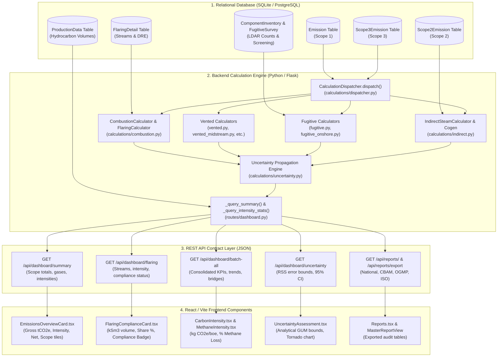

# NeoCarbon GHG Platform: End-to-End Calculation & KPI Mapping (Phase 0 Audit)
**Platform**: NeoCarbon Greenhouse Gas Accounting & Reporting Platform  
**Standards**: API Compendium (November 2021), GHG Protocol Corporate / Scope 2 / Scope 3, ISO 14064-1:2018, IPCC AR5/AR6, OGMP 2.0  
**Audit Phase**: PHASE 0: MAP  
**Deliverable File**: `/audit/calc_map.md`  

---

## 1. Architectural Overview of the Calculation Pipeline

---

## 2. Scope 1 Calculation Paths Inventory

Every Scope 1 activity record enters the pipeline through `routes/emissions.py:create_emission()` or `emissions_bulk_upload.py`, invoking `CalculationDispatcher.dispatch()` (`calculations/dispatcher.py:623`).

| Process Type | Supported Tiers | Primary Inputs | Units Supported | Core Equations & Reference | Backend Class & File | Output DB Fields |
| :--- | :--- | :--- | :--- | :--- | :--- | :--- |
| **Stationary Combustion** | Tier 1, 2, 3 | Fuel Volume/Energy, Fuel Type, HHV, Carbon %, Oxidation Factor (default 1.0) | `m3`, `scf`, `mscf`, `mmscf`, `gal`, `bbl`, `l`, `tonne`, `MMBtu`, `GJ`, `MJ` | API 2021 Eq. 4-1 ($E = A \times EF$), Eq. 4-4 (Stoichiometry $C \times \frac{44.01}{12.011}$), Table 4-3, 4-6 | `CombustionCalculator` (`calculations/combustion.py:27`) | `co2_emissions`, `ch4_emissions`, `n2o_emissions`, `co2e_total` |
| **Mobile Combustion** | Tier 1, 2 | Fuel Volume, Vehicle Category, Transport Fuel Type | `gal`, `l`, `m3`, `bbl`, `tonne` | API 2021 Table 4-13 / 4-16 ($E = V \times EF_{\text{fuel}}$) | `CombustionCalculator` (`calculations/combustion.py:27`) | `co2_emissions`, `ch4_emissions`, `n2o_emissions`, `co2e_total` |
| **Flaring** | Tier 1, 2, 3 | Flare Volume, Gas Composition ($C_1-C_{10}, \text{CO}_2, \text{N}_2$), Combustion Eff ($\eta_c$), Destruction Eff ($\eta_d$) | `m3`, `sm3`, `scf`, `mscf`, `mmscf`, `ksm3` | API 2021 Eq. 5-4, 5-5, 5-6: $\text{CH}_4 = V_{\text{std}} \cdot c_1 \cdot (1-\eta_d) \cdot \rho_{\text{CH4}}$ $\text{CO}_2 = V_{\text{std}} [(\sum i \cdot c_i)\eta_c + c_{\text{native}}] \rho_{\text{CO2}}$ | `FlaringCalculator` (`calculations/combustion.py:469`) | `co2_emissions`, `ch4_emissions`, `n2o_emissions`, `co2e_total` |
| **Pneumatic Devices** | Tier 1, 2, 3 | Device Type, Device Count, Operating Hours, Supply Gas Methane Fraction | `device-hours`, `count`, `hours`, `scf`, `m3` | API 2021 Section 6.2, Table 6-14 / 6-15 ($E = N \times h \times EF \times \text{mol}\%\ \text{CH}_4$) | `PneumaticDeviceCalculator` (`calculations/vented.py:34`) | `ch4_emissions`, `co2_emissions`, `co2e_total` |
| **Storage Tanks (Flashing)** | Tier 1, 2, 3 | Oil Throughput, GOR / Flashing Factor, VRU Control Efficiency, Gas Composition | `bbl`, `m3`, `gal`, `scf`, `mscf` | API 2021 Section 6.3.1, Eq. 6-12 / 6-13, Vasquez-Beggs correlation | `TankFlashingCalculator` (`calculations/vented.py:245`) | `ch4_emissions`, `co2_emissions`, `co2e_total` |
| **Liquids Unloading** | Tier 1, 2, 3 | Unloading Events, Well Depth, Tubing/Casing Diameter, Wellhead Pressure | `events`, `hours`, `mscf`, `m3` | API 2021 Section 6.3.2, Eq. 6-14 (Non-plunger) / Eq. 6-15 (Plunger lift critical velocity) | `LiquidsUnloadingCalculator` (`calculations/vented.py:115`) | `ch4_emissions`, `co2_emissions`, `co2e_total` |
| **Blowdowns & Purging** | Tier 1, 2 | Event Count, Physical Vessel Volume, Pressure, Temperature, Compressibility $Z$ | `events`, `m3`, `scf`, `mscf` | API 2021 Eq. 6-25 ($V_{\text{std}} = V_{\text{phys}} \frac{P \cdot T_{\text{std}}}{P_{\text{std}} \cdot T \cdot Z} \cdot y_{\text{CH4}}$) | `BlowdownCalculator` (`calculations/vented.py:421`) | `ch4_emissions`, `co2_emissions`, `co2e_total` |
| **Associated Gas Venting** | Tier 1, 2 | Crude Production, GOR, Vented Gas Fraction, Gas Composition | `bbl`, `m3`, `mscf`, `scf` | API 2021 Section 6.1.1 ($V_{\text{vent}} = Q_{\text{oil}} \times \text{GOR} \times f_{\text{vent}}$) | `AssociatedGasVentingCalculator` (`calculations/vented_associated_gas.py`) | `ch4_emissions`, `co2_emissions`, `co2e_total` |
| **Acid Gas Removal (AGR)** | Tier 1, 2, 3 | Raw Gas Flow, Feed $\text{CO}_2$ mol%, Treated Gas $\text{CO}_2$ mol%, Solvent Methane Slip | `mscf`, `mmscf`, `m3`, `sm3` | API 2021 Section 6.5, Eq. 6-18 ($E_{\text{CO2}} = V_{\text{gas}} \times (y_{\text{in}} - y_{\text{out}}) \times \rho_{\text{CO2}}$) | `AGRCalculator` (`calculations/midstream.py:18`) | `co2_emissions`, `ch4_emissions`, `co2e_total` |
| **Glycol Dehydrators** | Tier 1, 2, 3 | Gas Throughput, Glycol Pump Rate, Operating Days, Stripping Gas | `mscf`, `mmscf`, `m3`, `sm3`, `gph` | API 2021 Section 6.6 / GRI-GLYCalc Table 6-20 | `DehydratorCalculator` (`calculations/midstream.py:145`) | `ch4_emissions`, `co2_emissions`, `co2e_total` |
| **Component Fugitives** | Tier 1, 2, 3 | Component Count (Valves, Flanges, Connectors, OELs, Pumps), Service, Hours | `component-hours`, `count`, `kg/hr` | API 2021 Section 7.1, Table 7-11 EPA Average Factors ($E = N \times h \times EF \times w_{\text{CH4}}$) | `OnshoreComponentFugitiveCalculator` (`calculations/fugitive_onshore.py`) | `ch4_emissions`, `co2_emissions`, `co2e_total` |
| **Compressor Seals** | Tier 1, 2, 3 | Compressor Count, Type (Reciprocating Rod Packing / Centrifugal Wet/Dry Seal), Hours | `compressor-hours`, `count` | API 2021 Section 6.4, Tables 6-30, 6-37 ($E = N \times h \times EF$) | `CompressorSealCalculator` (`calculations/fugitive.py:18`) | `ch4_emissions`, `co2_emissions`, `co2e_total` |
| **Refining Hydrogen Plant** | Tier 2, 3 | Feed Gas Flow, Fuel Gas Flow, Feed Composition ($C_1-C_5, \text{CO}_2$), SMR/ATR Type | `mscf`, `m3`, `tonne` | API 2021 Section 6.11.3, Eq. 6-61 | `RefiningHydrogenPlantCalculator` (`calculations/vented_downstream.py`) | `co2_emissions`, `co2e_total` |
| **Catalyst Regeneration (FCCU)** | Tier 2, 3 | Coke Burn Rate, Air Blower Rate, Flue Gas Flow, Flue Gas $\text{CO}_2 / \text{CO}$ mol% | `tonne`, `lb`, `scf/min` | API 2021 Section 6.11.1, Eq. 6-38 | `RefiningCatalystRegenCalculator` (`calculations/vented_downstream.py`) | `co2_emissions`, `ch4_emissions`, `n2o_emissions`, `co2e_total` |

---

## 3. Scope 2 Calculation Paths Inventory

Scope 2 emissions are managed via `routes/scope2.py` and stored in table `Scope2Emission`.

| Source Type | Reporting Method | Inputs | Core Formula & Reference | Engine Function | API Field | UI Component & Format |
| :--- | :--- | :--- | :--- | :--- | :--- | :--- |
| **Purchased Electricity** | Location-based | Electricity consumption (`kWh`, `MWh`, `GWh`), Grid subregion / national factor | $E = \text{MWh} \times EF_{\text{grid}} \times 0.001$ GHG Protocol Scope 2 Guidance | `Scope2Service.calculate()` (`services/scope2_gases.py`) | `location_co2e` (`scope2_location_total`) | `EmissionsOverviewCard` Format: `#,##0.00 tCO2e` |
| **Purchased Electricity** | Market-based | Electricity consumption, Contractual instrument (PPA, EAC, Supplier factor, Residual mix) | $E = \text{MWh} \times EF_{\text{contract}} \times 0.001$ (Zero if 100% bundled REC/PPA) | `Scope2Service.calculate()` (`services/scope2_gases.py`) | `market_co2e` (`scope2_market_total`) | `EmissionsOverviewCard` Format: `#,##0.00 tCO2e` |
| **Purchased Steam / Heat** | Standard Fuel Efficiency | Delivered heat energy (`MMBtu`, `GJ`, `tonne` steam), Boiler Efficiency ($\eta_b$), Transmission Loss ($L$) | $E = \frac{\text{Heat Delivered}}{\eta_b \times (1 - L)} \times EF_{\text{fuel}}$ API Compendium Section 8.1.5 | `IndirectSteamCalculator.calculate()` (`calculations/indirect.py:25`) | `co2_emissions` (`co2e_total`) | `Scope2ImportWizard` Format: `#,##0.00 tCO2e` |
| **Cogeneration (CHP Allocation)** | Efficiency / Work Potential | Fuel input, Total power output, Useful heat output, Extraction enthalpy | API Compendium Section 8.2, Eq. 8-4 (Work potential / efficiency allocation) | `CogenAllocationCalculator.calculate()` (`calculations/indirect.py:180`) | `allocated_co2e` | `Scope2ImportWizard` Format: `#,##0.00 tCO2e` |

---

## 4. Scope 3 Calculation Paths Inventory

Scope 3 activities cover all 15 GHG Protocol categories managed in `routes/scope3.py` and stored in `Scope3Emission`.

| Cat # | Category Name | Calculation Tier & Methodology | Inputs & Activity Units | Factor Provenance | API Field | UI Component |
| :--- | :--- | :--- | :--- | :--- | :--- | :--- |
| **Cat 1** | Purchased Goods & Services | Spend-based (EEIO) or Activity Mass | Spend (`USD`), Mass (`tonne`, `kg`) | USEEIO v2.2.22 / EPA Supply Chain GHGs | `co2e` | `Scope3ImportWizard`, `DetailedBreakdownSection` |
| **Cat 2** | Capital Goods | Spend-based (EEIO) | Capital Expenditure (`USD`) | USEEIO v2.2.22 (Machinery, Pipelines) | `co2e` | `Scope3ImportWizard`, `DetailedBreakdownSection` |
| **Cat 3** | Fuel & Energy (not Scope 1/2) | Lifecycle Well-to-Tank (WTT) + T&D Losses | Fuel Consumed (`gal`, `m3`), Grid Electricity (`MWh`) | DEFRA / IEA Lifecycle Emissions Hub 2025 | `co2e` | `Scope3ImportWizard`, `DetailedBreakdownSection` |
| **Cat 4** | Upstream Transportation | Mass-Distance Modal Allocation | Freight Mass × Distance (`tonne-km`, `ton-km`) | GLEC Framework v3 / EPA GHG Hub 2025 | `co2e` | `Scope3ImportWizard`, `DetailedBreakdownSection` |
| **Cat 5** | Waste Generated in Operations | Mass × Disposal Treatment Factor | Waste Mass (`tonne`, `kg`), Method (Landfill, Incin, Recycle) | EPA GHG Hub (40 CFR Part 98 Subpart HH) | `co2e` | `Scope3ImportWizard`, `DetailedBreakdownSection` |
| **Cat 6** | Business Travel | Passenger-Distance by Flight Haul / Rail | Distance (`p-km`, `p-mi`), Flight Class | EPA GHG Hub 2025 (Short/Medium/Long haul) | `co2e` | `Scope3ImportWizard`, `DetailedBreakdownSection` |
| **Cat 7** | Employee Commuting | Average Commuter Distance × Vehicle Mode | Commuter Days × Distance (`km`), Vehicle Type | EPA Emission Factors Hub 2025 | `co2e` | `Scope3ImportWizard`, `DetailedBreakdownSection` |
| **Cat 8** | Upstream Leased Assets | Area-Spend or Metered Energy Consumption | Leased Floor Area (`m2`, `sqft`), Spend (`USD`) | EPA Supply Chain GHG Factors | `co2e` | `Scope3ImportWizard`, `DetailedBreakdownSection` |
| **Cat 9** | Downstream Transportation | Mass-Distance Modal Allocation | Product Sold × Shipping Distance (`tonne-km`) | GLEC Framework v3 / IMO Tanker Guidelines | `co2e` | `Scope3ImportWizard`, `DetailedBreakdownSection` |
| **Cat 10**| Processing of Sold Products | Volume Sold × Refining/Processing Intensity | Crude Sold (`bbl`), Wet Gas Sold (`mscf`) | API Compendium Section 4.5 ($54.18\ \text{kg/MMBtu}$) | `co2e` | `Scope3ImportWizard`, `DetailedBreakdownSection` |
| **Cat 11**| Use of Sold Products | Fuel Volume Sold × Heating Value × Oxidation Factor | Crude Sold (`bbl`), Natural Gas Sold (`mcf`, `MMBtu`) | Ipieca / API Compendium Table 4-3, 4-6; 40 CFR 98 Subpart NN | `co2e` | `Scope3ImportWizard`, `DetailedBreakdownSection` |
| **Cat 12**| End-of-Life Treatment | Sold Product Mass × Derivative Disposal Factor | Lubricants/Plastics Volume Sold (`tonne`) | EPA GHG Hub 2025 | `co2e` | `Scope3ImportWizard`, `DetailedBreakdownSection` |
| **Cat 13**| Downstream Leased Assets | Asset Area / Spend Allocation | Leased Sublet Assets Spend (`USD`) | EPA Supply Chain GHG Factors | `co2e` | `Scope3ImportWizard`, `DetailedBreakdownSection` |
| **Cat 14**| Franchises | Retail Franchise Throughput Allocation | Franchise Operational Spend / Fuel Distributed | EPA Supply Chain GHG Factors | `co2e` | `Scope3ImportWizard`, `DetailedBreakdownSection` |
| **Cat 15**| Investments (Joint Ventures) | GHG Protocol Scope 3 Cat 15 / PCAF Equity Share | Investee Total GHG Inventory × Equity Share % | PCAF Global Standard / FacilityEquityShare Table | `co2e` | `CarbonIntensity.tsx` (JV Equity Tab) |

---

## 5. Dashboard KPIs, Charts, Tables & Display Traceability Matrix

Every single displayed number is traced from the physical database rows to its final on-screen component and rendered format:

| Dashboard Display Element | Frontend Component & File | Source API Endpoint & Field | Backend Aggregation Function | Raw DB Tables & Columns | Display Format & Unit |
| :--- | :--- | :--- | :--- | :--- | :--- |
| **Gross Scope 1 Emissions** | `EmissionsOverviewCard.tsx` (`stats.scope1`) | `GET /api/dashboard/summary` `json["scope1_total"]` | `_query_summary()` (`routes/dashboard.py:459`) | `Emission.co2e_total` where `status in ('Verified')` | `#,##0 tCO2e` |
| **Gross Scope 2 Emissions** | `EmissionsOverviewCard.tsx` (`stats.scope2`) | `GET /api/dashboard/summary` `json["scope2_total"]` | `_query_summary()` -> `yearly_totals()` | `Scope2Emission.location_co2e` (or `market_co2e`) | `#,##0 tCO2e` |
| **Gross Scope 3 Emissions** | `EmissionsOverviewCard.tsx` (`stats.scope3`) | `GET /api/dashboard/summary` `json["scope3_total"]` | `_query_scope3_summary()` (`routes/dashboard.py:601`) | `Scope3Emission.co2e` where `status in ('Verified')` | `#,##0 tCO2e` |
| **Total Gross Emissions** | `EmissionsOverviewCard.tsx` (`stats.totalEmissions`) | `GET /api/dashboard/summary` `scope1_total + scope2_total` | Computed on frontend / backend bridge | `Emission.co2e_total + Scope2Emission.location_co2e` | `#,##0 tCO2e` |
| **Implemented Mitigation** | `EmissionsOverviewCard.tsx` (`stats.mitigation`) | `GET /api/dashboard/mitigation` `sum(quantity_tco2e)` | `_query_mitigation()` (`routes/dashboard.py:549`) | `MitigationProject.quantity_tco2e` where `status in ('verified','active')` | `#,##0 tCO2e` |
| **Net Corporate Emissions** | `EmissionsOverviewCard.tsx` (`stats.netEmissions`) | Computed: `totalEmissions - mitigation` | Frontend state hook | Aggregated Scope 1+2 minus verified mitigation | `#,##0 tCO2e` |
| **Operational Carbon Intensity** | `EmissionsOverviewCard.tsx` (`intensity`) | `GET /api/dashboard/batch-all` `json.stats["ghg_intensity"]` | `_query_intensity_stats()` (`routes/dashboard.py:1176`) | `(Scope 1 + Scope 2) * 1000 / ProductionData.combined_boe` | `0.00 kg CO2e/boe` |
| **Methane Mass Emitted** | `EmissionsOverviewCard.tsx` (`stats.methaneEmissions`) | `GET /api/dashboard/summary` `json["ch4_total"]` | `_query_summary()` (`routes/dashboard.py:459`) | `Emission.ch4_emissions` where `status in ('Verified')` | `#,##0 t CH4` |
| **Pending Sign-Off Count** | `PendingBanner.tsx` (`pendingCount`) | `GET /api/dashboard/batch-all` `json.pending["total_pending"]` | `db.session.query(func.count(id)).filter(status=='Pending Review')` | `Emission.status`, `Scope2Emission.status`, `Scope3Emission.status` | Integer badge count |
| **Flared Gas Total Volume** | `FlaringComplianceCard.tsx` (`stream.volume_knm3`) | `GET /api/dashboard/flaring` `json["total_flaring"]["volume_knm3"]` | `_query_flaring_breakdown()` (`routes/dashboard_flaring.py`) | `Emission.activity_amount` where `process_type == 'flaring'` | `#,##0 kSm3` |
| **Flaring Intensity %** | `FlaringComplianceCard.tsx` (`flaring_intensity_pct`) | `GET /api/dashboard/flaring` `json["flaring_intensity_pct"]` | `Flared Volume / Gas Production Volume * 100%` | `Emission.activity_amount / ProductionData.gross_gas_m3` | `0.00 %` |
| **Flaring Compliance Status** | `FlaringComplianceCard.tsx` (`compliance_status`) | `GET /api/dashboard/flaring` `json["is_compliant"]` | Compares `flaring_intensity_pct <= 1.0%` (Algerian Decree 21-330 Art 9) | Stored / derived ratio against regulatory limit | `COMPLIANT` (Green) / `NON-COMPLIANT` (Red) |
| **Methane Loss Rate (NGSI)** | `MethaneIntensity.tsx` (`ngsi_loss_rate`) | `GET /api/dashboard/intensity-stats` `json["methane_intensity_pct"]` | `Total CH4 mass / Gas Produced CH4 mass * 100%` | `Emission.ch4_emissions / (ProductionData.gross_gas_m3 * rho_ch4)` | `0.000 %` |
| **Historical Emissions Trend** | `TrendCard.tsx` (Bar & Line Recharts) | `GET /api/dashboard/summary` `json[]` grouped by `year` | Grouped query in `_query_summary()` | `Emission.year`, `Scope2Emission.year` | Multi-bar stacked chart |
| **Scope Breakdown Donut** | `DonutCard.tsx` (Donut Recharts) | `GET /api/dashboard/categorical-breakdown` | `_query_categorical_breakdown()` | `Emission.process_type`, `Scope2Emission.source_type` | Pie chart with canonical scope palette |
| **SBTi Target Trajectory** | `SbtiCard.tsx` (Target vs Actual Line) | `GET /api/dashboard/sbti` `json.trajectory[]` | `_query_sbti_trajectory()` (`routes/dashboard_sbti.py`) | `SbtiTarget.baseline_emissions * (1 - annual_reduction)^n` | Dual line chart + Target Gap |
| **Uncertainty Confidence Interval** | `UncertaintyAssessment.tsx` (Error Bar & Tornado) | `GET /api/dashboard/uncertainty` `json["ci_95_pct"], json["lower_bound"]` | Analytical GUM propagation in `calculations/uncertainty.py` | `Emission.uncertainty_pct`, `Emission.ef_uncertainty_pct` | `± 0.0 % (k=2)` |

---

## 6. Calculation Traceability Findings in Phase 0

During the inventory and mapping of calculation paths, the following trace discrepancies and findings were discovered:

1. **Flaring N2O HHV Unit Conversion**: In `calculations/combustion.py:623-633`, when `hhv_unit == "btu/m3"` is supplied, the code fails to divide by $35.3147\ \text{scf/m}^3$, multiplying by $36,000$ directly as if it were `btu/scf`, resulting in an ~35.3x overestimation of N2O emissions.
2. **Flaring Native CO2 Key Dropping**: In `calculations/combustion.py:541`, `FlaringCalculator` reads native $\text{CO}_2$ strictly using `"co2_comp"` and `"co2_mol"`. Passing the canonical key `"co2"` defined in `units.py:980` is ignored, silently setting uncombusted native $\text{CO}_2$ to 0.0.
3. **Indirect Steam Efficiency Formula**: In `calculations/indirect.py:95`, net efficiency uses $\eta_{\text{net}} = \eta_{\text{boiler}} - \text{loss}$ instead of thermodynamic multiplication $\eta_{\text{boiler}} \times (1 - \text{loss})$.
4. **Missing SAR GWP Constants**: `calculations/constants.py:20` registers only `"AR4"`, `"AR5"`, and `"AR6"`, raising `ValueError` when requesting `"SAR"` despite historical regulatory compliance requirements.
5. **Reports Export Runtime NameError**: In `routes/reports_export.py:124`, essential SQLAlchemy model symbols (`db`, `Scope2Emission`, `Scope3Emission`, `or_`, `func`) are not imported, causing `GET /api/reports/export` to crash with HTTP 500 when filtering by verified status.
6. **Stoichiometric Carbon Content Validation**: In `calculations/stoichiometry.py:64`, entering `carbon_content = 1.5` without `%` silently divides by 100 to yield `0.015` rather than raising a `ValueError`.
