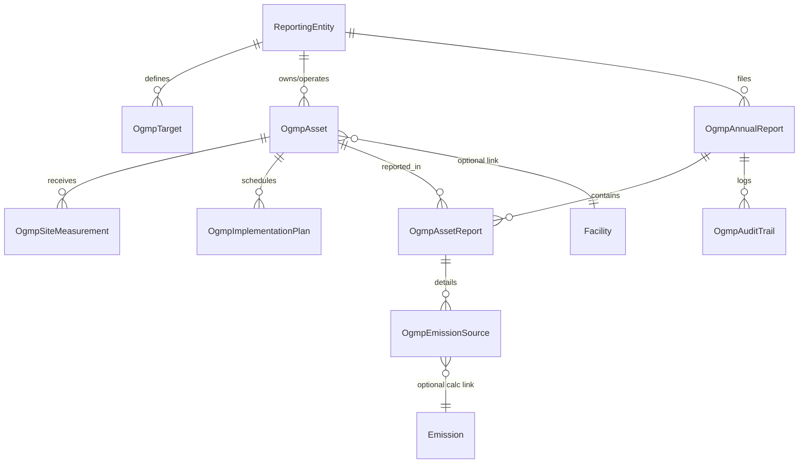

# GATE 0: OGMP 2.0 Official Files Analysis & Proposed Schema

**Date:** 2026-11-10  
**Module:** OGMP 2.0 Methane MRV Reporting Module  
**Status:** Ready for Review (GATE 0)

---

## 1. Inventory of Official Files Analyzed (in `/docs/ogmp/`)

| File Name | Format | Size | Description / Source |
|---|---|---|---|
| `OGMP2_Upstream_Reporting_Template.xlsx` | Excel (`.xlsx`) | 112 KB | Official UNEP / IMEO Upstream annual disclosure workbook |
| `OGMP2_Mid_Downstream_Reporting_Template.xlsx` | Excel (`.xlsx`) | 90 KB | Official UNEP / IMEO Mid & Downstream annual disclosure workbook |
| `OGMP2_Portfolio_Materiality_Template.xlsx` | Excel (`.xlsx`) | 23 KB | Official portfolio materiality assessment & staged roadmap template |
| `OGMP2_Reporting_Checklist.xlsx` | Excel (`.xlsx`) | 32 KB | UNEP member pre-submission checklist |
| `OGMP2_Guidance_Upstream.pdf` | PDF | 882 KB | Official guidance document for completing Upstream reporting template |
| `OGMP2_Guidance_Mid_Downstream.pdf` | PDF | 1.28 MB | Official guidance document for completing Mid/Downstream template |
| `OGMP2_Reporting_Framework.pdf` | PDF | 410 KB | UNEP / CCAC OGMP 2.0 Core Reporting Framework |
| `OGMP2_Implementation_Plan_Template.docx` | Word (`.docx`) | 110 KB | Official implementation plan template & scorecard criteria |
| `OGMP2_Level_5_Assessment.pdf` | PDF | 276 KB | Guidance on Level 5 site-level measurement assessment |
| `OGMP2_Reconciliation_and_Level_5_Guidance.pdf` | PDF | 714 KB | Technical guidance on bottom-up vs top-down reconciliation |

---

## 2. Template Structure & Field Mapping

### 2.1 Upstream Template: `L3, L4 and L5 Assets`

The core Upstream reporting sheet contains **81 columns** organized into asset metadata, 15 individual source categories (each with 4 columns), aggregate totals, and Level 5 site measurement reconciliation.

#### A. Asset / Venture Metadata (Columns 1–11)
| Col | Excel Header | Cell Range | Type / Validation | Target App Model Field |
|---|---|---|---|---|
| A (1) | `Asset/ Venture Name` | Row 3 | Text, Mandatory | `OgmpAsset.name` |
| B (2) | `Asset id` | Row 3 | Text, UNEP Member ID, Mandatory | `OgmpAsset.asset_id` |
| C (3) | `Type of Asset` | Row 3 | Dropdown (8 options)* | `OgmpAsset.asset_type` |
| D (4) | `Description of the Asset` | Row 3 | Text | `OgmpAsset.description` |
| E (5) | `Country` | Row 3 | List of Countries (194 countries) | `OgmpAsset.country` |
| F (6) | `Latitude` | Row 3 | Decimal [-90.0, 90.0] (WGS84) | `OgmpAsset.latitude` |
| G (7) | `Longitude` | Row 3 | Decimal [-180.0, 180.0] (WGS84) | `OgmpAsset.longitude` |
| H (8) | `Operated?` | Row 3 | Dropdown: `Yes`, `No` | `OgmpAsset.is_operated` |
| I (9) | `Operator` | Row 3 | Text (Operator name) | `OgmpAsset.operator_name` |
| J (10) | `% Equity (Note- Ownership)` | Row 3 | Decimal [0.0, 1.0] | `OgmpAsset.equity_share` |
| K (11) | `Specify type of equity` | Row 3 | Dropdown (10 options)** | `OgmpAsset.equity_type` |

*\* Asset Type Dropdown Values:*
`Exploration`, `Abandoned wells`, `Production per region/basin: Onshore – Conventional`, `Production per region/basin: Onshore – Unconventional`, `Production Offshore`, `Gas Processing Unit`, `Gathering and boosting facilities`, `Tank batteries`.

*\*\* Equity Type Dropdown Values:*
`Working Interest`, `Financial Equity`, `Ownership equity`, `Operational equity`, `Production enhancement contract`, `Technical service contract`, `Production sharing agreement`, `Association contract agreement`, `Production-weighted working interest`, `Other`.

#### B. The 15 Upstream Source Categories (Columns 12–71)
Each of the 15 sources has 4 standardized sub-columns:
1. `Methane emissions in metric tonnes` (`emissions_tch4`)
2. `Reporting level` (`reporting_level` Dropdown: `Level 3`, `Level 4`)
3. `L4 Uncertainty when reporting at L5` (`uncertainty_pct`, Float)
4. `L4 method` (`quantification_method` Dropdown: `Measurement based emission factor`, `Detailed engineering calculations`, `Simulation tool`, `Continuous measurements`, `Others`)

| # | Source Category Name | Excel Columns | Mapped Source Code |
|---|---|---|---|
| 1 | Combustion sources (incomplete combustion) | L (12) - O (15) | `combustion` |
| 2 | Flaring (Incomplete Combustion) | P (16) - S (19) | `flaring_incomplete` |
| 3 | Unlit Flaring | T (20) - W (23) | `flaring_unlit` |
| 4 | Fugitive Component and Equipment Leaks | X (24) - AA (27) | `fugitive_leaks` |
| 5 | Natural gas driven pneumatic equipment | AB (28) - AE (31) | `venting_pneumatics` |
| 6 | Centrifugal compressor shaft seals | AF (32) - AI (35) | `venting_centrifugal_compressor` |
| 7 | Reciprocating compressor rod packing | AJ (36) - AM (39) | `venting_reciprocating_compressor` |
| 8 | Glycol dehydrators | AN (40) - AQ (43) | `venting_glycol_dehydrators` |
| 9 | Tanks | AR (44) - AU (47) | `venting_tanks` |
| 10 | Well liquids unloading | AV (48) - AY (51) | `venting_liquids_unloading` |
| 11 | Well casinghead venting | AZ (52) - BC (55) | `venting_casinghead` |
| 12 | Hydraulic fracture completions | BD (56) - BG (59) | `venting_completions` |
| 13 | Crude Oil Loading/Offloading | BH (60) - BK (63) | `venting_loading` |
| 14 | Venting - Other | BL (64) - BO (67) | `venting_other` |
| 15 | Other Sources | BP (68) - BS (71) | `other_sources` |
| - | Other sources description | BT (72) | `source_info_other` |

#### C. Totals & Level 5 Reconciliation (Columns 73–81)
| Col | Excel Header | Description & Validation | Target App Model Field |
|---|---|---|---|
| BU (73) | `Total emissions` | Sum of source emissions (t CH4) | `OgmpAssetReport.total_source_emissions_tch4` |
| BV (74) | `Uncertainty` | Overall bottom-up uncertainty (%) | `OgmpAssetReport.source_aggregate_uncertainty_pct` |
| BW (75) | `Comments` | Free text comments | `OgmpAssetReport.comments` |
| BX (76) | `Comments if zero emissions` | Required if any source is reported as 0 | `OgmpAssetReport.zero_emissions_comments` |
| BY (77) | `Comments on variation from prior year` | Required if YoY variance > 10% | `OgmpAssetReport.yoy_variation_comments` |
| BZ (78) | `Level 5 - Total emissions` | Site-level measurement result (t CH4) | `OgmpAssetReport.site_level_emissions_tch4` |
| CA (79) | `Uncertainty` | Site-level measurement uncertainty (%) | `OgmpAssetReport.site_level_uncertainty_pct` |
| CB (80) | `Additional information` | Reconciliation narrative & methodology | `OgmpAssetReport.reconciliation_notes` |
| CC (81) | `Investments/divestments` | Dropdown: `Yes`, `No` | `OgmpAssetReport.investments_divestments_flag` |

---

### 2.2 Excluded Entities Tab: `List of Excluded Entities`

Mandatory tab for all excluded assets (assets with < 5% equity, divested assets, or non-producing/non-operated assets).

| Col | Excel Header | Type / Validation | Target App Model Field |
|---|---|---|---|
| A (1) | `Asset/ Venture Name` | Text, Mandatory | `OgmpAsset.name` |
| B (2) | `Asset id` | Text, Mandatory | `OgmpAsset.asset_id` |
| C (3) | `Asset Type` | Dropdown (same 8 Upstream options) | `OgmpAsset.asset_type` |
| D (4) | `Reason for exclusion` | Dropdown (7 values)*, Mandatory | `OgmpAsset.exclusion_reason` |
| E (5) | `Country` | Text | `OgmpAsset.country` |
| F (6) | `Latitude` | Decimal [-90.0, 90.0] | `OgmpAsset.latitude` |
| G (7) | `Longitude` | Decimal [-180.0, 180.0] | `OgmpAsset.longitude` |
| H (8) | `Operated?` | Dropdown: `Yes`, `No` | `OgmpAsset.is_operated` |
| I (9) | `Operator` | Text | `OgmpAsset.operator_name` |
| J (10) | `Reported by another OGMP 2.0 Member?` | Dropdown: `Yes`, `No` | `OgmpAsset.reported_by_other_member` |
| K (11) | `% Equity` | Decimal [0.0, 1.0] | `OgmpAsset.equity_share` |
| L (12) | `(Divested assets) Month/year` | Format MM/YYYY | `OgmpAsset.divestment_date` |
| M (13) | `(Divested assets) Divested to OGMP2.0 member?` | Dropdown: `Yes`, `No` | `OgmpAsset.divested_to_member` |
| N (14) | `Comments` | Text | `OgmpAsset.exclusion_comments` |

*\* Allowed Reason for Exclusion Values:*
1. `Reported by another OGMP 2.0 Member`
2. `Materiality Rule` (e.g. Non-operated assets with < 5% equity)
3. `Divested`
4. `Non-producing / Non-operational`
5. `No permission to report`
6. `Subsea tieback`
7. `Other`

---

### 2.3 Mid & Downstream Template: Structure & Segment Sheets

The Mid/Downstream template divides reporting across **12 segment sheets**:
1. `LNG Liquefaction`
2. `LNG Regasification`
3. `Shipping`
4. `LNG transport - truck or train`
5. `UGS` (Underground Gas Storage)
6. `Transmission - Pipelines`
7. `Transmission - Compressors`
8. `Transmission - Stations`
9. `Transmission - LNG Peak shaving`
10. `Distribution - Compressor`
11. `Distribution - Grid`
12. `Distribution - LNG Satellite`

**Per-source structure in Mid/Downstream:**
- Asset Header (Rows 1–10): Asset Name, ID, Type, Country, Lat/Lon, Operated (Yes/No), Operator, % Equity.
- Source rows: Activity Factors (`Data`, `Unit`), Emission Factors (`Data`, `Unit`), Methane Emissions (`t CH4`), Uncertainty (`%`), Reporting Level (`Level 1`, `Level 2`, `Level 3`, `Level 4`), `L4 method` (`Measurement based emission factor`, `Detailed engineering calculations`, `Simulation tool`, `Continuous measurements`, `Others`).

---

### 2.4 Portfolio Materiality Template: `Template Portfolio Mat`

Contains the 95% portfolio ranking matrix:
- Mode: `Entire portfolio`, `Split:Operated`, `Split:Non-ops`
- Asset Columns: Asset Name, Asset ID, Operated (`Yes`/`No`), Absolute emissions in base year (`kt CH4`), Materiality %, Cumulative %, Material? (`Yes`/`No`).
- Staged pathway columns `Y0` through `Y10`: Projected reporting level per year (`L1`, `L2`, `L3`, `L4`, `L5`).
- Current Year Columns: Current year emissions, current year materiality %.

---

## 3. Proposed Database Schema (SQLAlchemy / Alembic)

To preserve existing GHG calculator tables intact and prevent regressions, all OGMP 2.0 tables are created with clear foreign keys and indexed columns.



### 3.1 Model Definitions

```python
class ReportingEntity(db.Model):
    __tablename__ = "ogmp_reporting_entities"
    id = db.Column(db.Integer, primary_key=True)
    company_name = db.Column(db.String(120), nullable=False, index=True)
    unep_member_id = db.Column(db.String(50), unique=True, nullable=False, index=True)
    join_year = db.Column(db.Integer, nullable=False)
    segment_scope = db.Column(db.String(50), default="upstream")  # 'upstream', 'mid_downstream', 'both'
    contact_name = db.Column(db.String(120))
    contact_email = db.Column(db.String(120))
    created_at = db.Column(db.DateTime, default=datetime.utcnow)
    updated_at = db.Column(db.DateTime, default=datetime.utcnow, onupdate=datetime.utcnow)

class OgmpTarget(db.Model):
    __tablename__ = "ogmp_targets"
    id = db.Column(db.Integer, primary_key=True)
    entity_id = db.Column(db.Integer, db.ForeignKey("ogmp_reporting_entities.id"), nullable=False, index=True)
    target_type = db.Column(db.String(30), nullable=False)  # 'intensity', 'absolute'
    target_value = db.Column(db.Float, nullable=False)      # e.g. 0.20 (% intensity) or 45.0 (% reduction)
    target_unit = db.Column(db.String(50), nullable=False)   # '% of marketed gas', '% reduction', 'kg CH4/boe'
    denominator_type = db.Column(db.String(50))             # 'marketed_gas', 'gross_gas', 'boe'
    baseline_year = db.Column(db.Integer)
    baseline_emissions_tch4 = db.Column(db.Float)
    target_year = db.Column(db.Integer, nullable=False)
    status = db.Column(db.String(30), default="Underway")    # New, Underway, Achieved, Expired, Revised, Retired
    comments = db.Column(db.Text)
    created_at = db.Column(db.DateTime, default=datetime.utcnow)

class OgmpAsset(db.Model):
    __tablename__ = "ogmp_assets"
    id = db.Column(db.Integer, primary_key=True)
    entity_id = db.Column(db.Integer, db.ForeignKey("ogmp_reporting_entities.id"), nullable=False, index=True)
    facility_id = db.Column(db.Integer, db.ForeignKey("facilities.id"), nullable=True, index=True)  # link to existing facility
    asset_id = db.Column(db.String(50), nullable=False, index=True)  # UNEP asset code
    name = db.Column(db.String(120), nullable=False, index=True)
    segment = db.Column(db.String(30), default="upstream", index=True)
    asset_type = db.Column(db.String(100), nullable=False)  # from official template dropdown
    description = db.Column(db.Text)
    country = db.Column(db.String(100), nullable=False)
    latitude = db.Column(db.Float, nullable=False)
    longitude = db.Column(db.Float, nullable=False)
    is_operated = db.Column(db.Boolean, nullable=False, default=True, index=True)
    operator_name = db.Column(db.String(120))
    equity_share = db.Column(db.Float, nullable=False)       # 0.0 to 1.0
    equity_type = db.Column(db.String(50), nullable=False)   # from official dropdown
    is_excluded = db.Column(db.Boolean, default=False, index=True)
    exclusion_reason = db.Column(db.String(100))             # from official 7 options
    reported_by_other_member = db.Column(db.Boolean, default=False)
    divestment_date = db.Column(db.String(20))               # MM/YYYY
    divested_to_member = db.Column(db.Boolean)
    exclusion_comments = db.Column(db.Text)
    created_at = db.Column(db.DateTime, default=datetime.utcnow)
    updated_at = db.Column(db.DateTime, default=datetime.utcnow, onupdate=datetime.utcnow)

class OgmpAnnualReport(db.Model):
    __tablename__ = "ogmp_annual_reports"
    id = db.Column(db.Integer, primary_key=True)
    entity_id = db.Column(db.Integer, db.ForeignKey("ogmp_reporting_entities.id"), nullable=False, index=True)
    year = db.Column(db.Integer, nullable=False, index=True)
    segment = db.Column(db.String(30), nullable=False, default="upstream")
    status = db.Column(db.String(30), nullable=False, default="draft", index=True)  # 'draft', 'validated', 'submitted'
    version = db.Column(db.Integer, nullable=False, default=1)
    snapshot_json = db.Column(db.Text)  # JSON frozen copy upon submission
    submitted_by = db.Column(db.Integer, db.ForeignKey("users.id"), nullable=True)
    submitted_at = db.Column(db.DateTime, nullable=True)
    created_at = db.Column(db.DateTime, default=datetime.utcnow)
    updated_at = db.Column(db.DateTime, default=datetime.utcnow, onupdate=datetime.utcnow)

class OgmpAssetReport(db.Model):
    __tablename__ = "ogmp_asset_reports"
    id = db.Column(db.Integer, primary_key=True)
    annual_report_id = db.Column(db.Integer, db.ForeignKey("ogmp_annual_reports.id"), nullable=False, index=True)
    asset_id = db.Column(db.Integer, db.ForeignKey("ogmp_assets.id"), nullable=False, index=True)
    reported_level = db.Column(db.Integer, nullable=False, default=1)  # 1 to 5
    is_material = db.Column(db.Boolean, default=True, index=True)
    materiality_rank = db.Column(db.Integer)
    absolute_emissions_tch4 = db.Column(db.Float, default=0.0)
    materiality_pct = db.Column(db.Float, default=0.0)
    cumulative_materiality_pct = db.Column(db.Float, default=0.0)
    total_source_emissions_tch4 = db.Column(db.Float, default=0.0)
    source_aggregate_uncertainty_pct = db.Column(db.Float)
    site_level_emissions_tch4 = db.Column(db.Float)
    site_level_uncertainty_pct = db.Column(db.Float)
    reconciliation_variance_pct = db.Column(db.Float)
    reconciliation_status = db.Column(db.String(50))
    reconciliation_notes = db.Column(db.Text)
    l4_emissions_coverage_pct = db.Column(db.Float, default=0.0)
    l4_sub_90_justification = db.Column(db.Text)
    comments = db.Column(db.Text)
    zero_emissions_comments = db.Column(db.Text)
    yoy_variation_comments = db.Column(db.Text)
    investments_divestments_flag = db.Column(db.Boolean, default=False)

class OgmpEmissionSource(db.Model):
    __tablename__ = "ogmp_emission_sources"
    id = db.Column(db.Integer, primary_key=True)
    asset_report_id = db.Column(db.Integer, db.ForeignKey("ogmp_asset_reports.id"), nullable=False, index=True)
    source_category_code = db.Column(db.String(50), nullable=False, index=True)
    source_category_name = db.Column(db.String(100), nullable=False)
    reporting_level = db.Column(db.Integer, nullable=False)  # 3 or 4
    emissions_tch4 = db.Column(db.Float, nullable=False, default=0.0)
    uncertainty_pct = db.Column(db.Float)
    quantification_method = db.Column(db.String(100))  # from official template dropdown
    source_info_other = db.Column(db.Text)
    emission_ref_id = db.Column(db.Integer, db.ForeignKey("emissions.id"), nullable=True, index=True)
    is_override = db.Column(db.Boolean, default=False)

class OgmpSiteMeasurement(db.Model):
    __tablename__ = "ogmp_site_measurements"
    id = db.Column(db.Integer, primary_key=True)
    asset_id = db.Column(db.Integer, db.ForeignKey("ogmp_assets.id"), nullable=False, index=True)
    year = db.Column(db.Integer, nullable=False, index=True)
    campaign_date = db.Column(db.Date, nullable=False)
    technology = db.Column(db.String(100), nullable=False)  # OGI, Aerial flyover, Satellite, CEMS, Tracer
    instrument_vendor = db.Column(db.String(120))
    measured_rate_kg_hr = db.Column(db.Float)
    annualized_emissions_tch4 = db.Column(db.Float, nullable=False)
    detection_threshold = db.Column(db.Float)
    uncertainty_pct = db.Column(db.Float)
    raw_data_ref = db.Column(db.String(255))
    notes = db.Column(db.Text)
    created_by = db.Column(db.Integer, db.ForeignKey("users.id"))
    created_at = db.Column(db.DateTime, default=datetime.utcnow)

class OgmpImplementationPlan(db.Model):
    __tablename__ = "ogmp_implementation_plans"
    id = db.Column(db.Integer, primary_key=True)
    entity_id = db.Column(db.Integer, db.ForeignKey("ogmp_reporting_entities.id"), nullable=False, index=True)
    asset_id = db.Column(db.Integer, db.ForeignKey("ogmp_assets.id"), nullable=False, index=True)
    year_index = db.Column(db.String(10), nullable=False)  # 'Y0', 'Y1', 'Y2', 'Y3', 'Y4', 'Y5'
    calendar_year = db.Column(db.Integer, nullable=False)
    planned_level = db.Column(db.Integer, nullable=False)  # 1 to 5
    actual_level = db.Column(db.Integer)
    is_on_track = db.Column(db.Boolean, default=True)
    action_plan_summary = db.Column(db.Text)

class OgmpAuditTrail(db.Model):
    __tablename__ = "ogmp_audit_trail"
    id = db.Column(db.Integer, primary_key=True)
    annual_report_id = db.Column(db.Integer, db.ForeignKey("ogmp_annual_reports.id"), nullable=False, index=True)
    user_id = db.Column(db.Integer, db.ForeignKey("users.id"), nullable=False, index=True)
    action = db.Column(db.String(50), nullable=False)  # CREATE, VALIDATE, SUBMIT, EXPORT, OVERRIDE
    details = db.Column(db.Text)
    timestamp = db.Column(db.DateTime, default=datetime.utcnow, nullable=False, index=True)
```

---

## 4. Register of Unverified Items

Per the rule *"Never invent emission factors, thresholds, or template fields. If something is not in the official files, mark it TODO and add it to an 'unverified items' register"*:

| ID | Item Description | Status / Handling in Design |
|---|---|---|
| **U-01** | UNEP IMEO Direct WebApp API Submission Endpoints | Marked **TODO**. No public REST API endpoints exist for automated direct upload; the module will generate and validate official `.xlsx` workbooks ready for manual member upload. |
| **U-02** | Official Mathematical Standard for Multi-Source Uncertainty Aggregation | Marked **TODO**. Neither template nor guidance mandates a single formula; standard RSS (Root-Sum-Square) error propagation per ISO GUM / IPCC Approach 1 is implemented. |
| **U-03** | Mid/Downstream Sheet-Specific Level 5 Columns | Marked **TODO**. Mid/Downstream template lacks the explicit Col BZ/CA Level 5 columns present in Upstream; site-level measurement reconciliation for Mid/Downstream is recorded in asset notes and reported via the reconciliation register. |

---

## 5. GATE 0 Checklist

- [x] All 10 official OGMP 2.0 files retrieved and located in `/docs/ogmp/`.
- [x] Both `.xlsx` templates parsed with openpyxl (sheets, rows, columns, dropdowns, formulas, excluded tabs extracted).
- [x] All 15 Upstream source categories and 12 Mid/Downstream segments mapped to code constants.
- [x] Complete field-by-field mapping between template columns and application models established.
- [x] Proposed SQLAlchemy relational schema designed with indices, foreign keys, and audit logging.
- [x] Existing test suite verified baseline clean (14 passed, 0 failed).
- [x] Unverified items register initialized.
